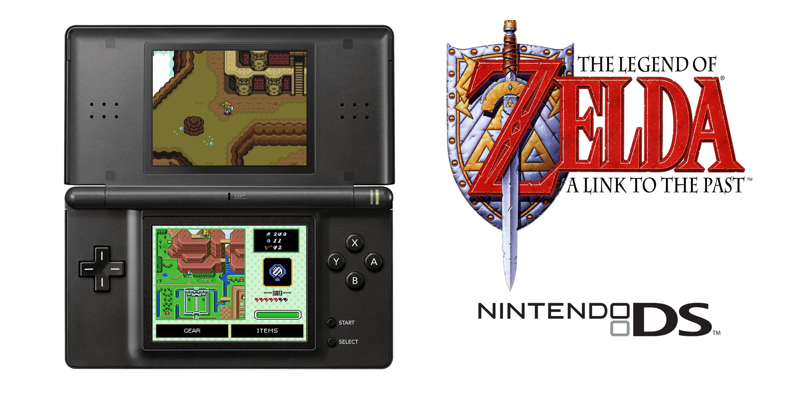

# A Link To The Past DS

*The Legend of Zelda: A Link to the Past* Dual Screen port for the Nintendo DS / DS Lite.

<p align="center">
  
</p>

ALTTP DS is a homebrew port of [snesrev/zelda3](https://github.com/snesrev/zelda3), a C reimplementation of the SNES game. It is not an emulator. The game logic runs natively on the DS's ARM9. The picture is built on the DS 2D engine, and the music plays on the DS sound hardware. The bottom screen can show a touch HUD with an item panel, a gear panel, and a live world or dungeon map.

> **You supply the game data.** This repo contains no Nintendo ROM and no game assets. You build `zelda3_assets.dat` from a USA *A Link to the Past* ROM that you own (see [Step 2](#2-extract-the-game-assets)). This project is not affiliated with or endorsed by Nintendo.

## Features

### A native port, not an emulator

- **Full game.** The whole game from the title screen onward, running zelda3's reimplemented game logic on the DS's ARM9.
- **DS 2D engine renderer.** SNES backgrounds, sprites, windows, mosaic, color math, and the door iris map onto DS tile layers, hardware sprites, and palettes. The world map uses a hardware affine layer, so each scanline keeps the Mode 7 perspective.
- **Cropped screen handled for you.** The SNES picture is 224 lines and the DS screen is 192. The overworld and dungeon cameras scroll a little past room and area edges, so Link and the action stay in view.
- **Lid handling.** Closing the DS lid pauses the game and the music, and opening it wakes both. On a loaded game, closing the lid opens the save menu.

### Bottom-screen HUD and touch controls

Set **HUD** to **Bottom Screen** in Settings and the status bar moves off the top screen, so the whole top screen is the game. The bottom screen then shows:

- Hearts, magic meter, rupee, bomb and arrow counters, and the equipped item.
- A **live map**: the world map outdoors and the dungeon map inside a dungeon. It stays black in caves and houses.
- An **Items** button, which opens and closes the game's item menu.
- A **Gear** button, which opens a panel with your equipment, bottles, pendants, crystals, hearts, and heart pieces. The game pauses while it is open.
- **Touch to equip.** Tap an item on the item panel to equip it, with no D-pad needed.

When no game is running (title, file select, boot), the bottom screen shows a Triforce idle picture.

### Quality-of-life additions

- **Settings menu.** Open it from the save menu (see [Settings](#settings)).
- **Title skip.** Pressing a button during the intro jumps to the sword drop, after a short bit of the title theme.
- **Fast dialogue.** Hold **A** to speed through dialogue that has no text box, such as Zelda's plea.
- **Launcher icon and title.** The ROM has its own banner icon and title in the DS launcher and in Twilight Menu++.

### Settings

Press **Select** in game to open the save menu. It has three rows: **Continue**, **Save and Quit**, and **Settings**. **B** also continues. Settings are saved in your `.sav` file.

| Setting | Options | What it does |
|---|---|---|
| HUD | Top Screen / Bottom Screen | Where the status bar and touch HUD live |
| Low HP Indicator | On / Off | The low-health beep |
| Spawn | Normal / Dungeon | A save made inside a dungeon loads at that dungeon's entrance |
| Magic Mirror | Normal / Free | Removes magic mirror use restrictions |
| Bomb Capacity | 10 / 99 | Maximum bombs you can carry |
| Arrow Capacity | 30 / 99 | Maximum arrows you can carry |
| Run Speed | Normal / Double / Triple | How fast Link walks, dashes, and swims |
| Dark Rooms | Normal / Bright | Bright keeps dark rooms lit, so the lantern is optional |
| Hair Color | Pink / Blonde | Link's hair color |
| Button Mapping | | Allows you to remap the controls |

In the menu, **Up/Down** moves, **Left/Right** changes a value, **A** or **Start** confirms on **Save** or **Cancel**, and **B** cancels.

## Controls
You can remap the controls however you like in the settings menu.

## Getting started

### What you need

- A **USA** *A Link to the Past* ROM that you own, named `zelda3.sfc`.
  SHA-256: `66871d66be19ad2c34c927d6b14cd8eb6fc3181965b6e517cb361f7316009cfb`
- [devkitPro](https://devkitpro.org/) with **devkitARM** and **libnds**. Install the `nds-dev` package group. The build is tested with libnds 2.0 on Windows and expects devkitPro at `C:\devkitPro`.
- [Python 3](https://www.python.org/) with `Pillow` and `PyYAML` (`pip install Pillow PyYAML`).
- Git.
- To run it: [melonDS](https://melonds.melonemu.org/) or a DS / DS Lite with a DLDI flashcart.

### 1. Clone

The game logic is in the `vendor/zelda3` submodule, so clone with submodules:

```sh
git clone --recurse-submodules https://github.com/JimmyGlasscock/alttp-ds.git
cd alttp-ds
```

If you already cloned without them: `git submodule update --init`.

### 2. Extract the game assets

Copy your ROM to `vendor/zelda3/zelda3.sfc`, then:

```sh
cd vendor/zelda3
python assets/restool.py --extract-from-rom
```

This creates `zelda3_assets.dat` (about 684 KB). Copy it to the project root:

```sh
copy zelda3_assets.dat ..\..\zelda3_assets.dat
```

Neither the ROM nor `zelda3_assets.dat` is committed. Both are in `.gitignore`.

### 3. Build

From the project root on Windows:

```bat
build.bat
```

`build.bat` sets up the devkitPro environment, copies `zelda3_assets.dat` into the ROM's NitroFS, and runs `make`. From an MSYS2 or Unix shell with `DEVKITARM` set, run `make`. Copy `zelda3_assets.dat` into `platform/nds/nitrofiles/` yourself in that case.

The build also compiles the ARM7 sound core in `platform/nds/arm7`. The output is **`lttp-ds.nds`** in the project root. `make clean` cleans both.

### 4. Run

**melonDS**

1. Open `lttp-ds.nds`.
2. For saves to persist, go to *Config → Emu settings → DLDI*, turn on DLDI and folder sync, and pick a folder.
3. Your save appears there as `lttp-ds.sav`.

**DS / DS Lite flashcart**

1. Copy `lttp-ds.nds` to the card and launch it with your usual loader. Twilight Menu++ also works.
2. The save follows TWiLight Menu++ Save Location. The default is a `saves` folder next to the ROM (`lttp-ds.sav`, or the ROM's own name if you renamed it). The other settings put that file beside the ROM, or in `_nds/TWiLightMenu/saves`. A `lttp-ds.sav` left at the card root by an older build is loaded and moved on the next save. This needs a loader that patches in the card's DLDI driver, which most do.
3. The game assets are inside the `.nds`, so no other files are needed.

## Saves

- On a flashcart the save is an 8 KB `.sav` in TWiLight Menu++'s save location, named after the ROM. It holds the three game slots and your Settings. melonDS folder sync still writes `lttp-ds.sav` in the synced folder.
- Settings are stored in unused space past the save slots, so they travel with the file.
- A save from an older build at the card root, or in `saves/sram.dat`, is still read and written to that location on the next save.

## Not included

These zelda3 extras are left out on purpose, because the DS cannot run them or has no use for them: shaders, widescreen, 240-line mode, hi-res Mode 7, MSU-1 / Opus audio, OpenGL, and the ROM comparison mode.

## Project layout

```
alttp-ds/
  vendor/zelda3/        game logic, PPU and audio code (git submodule)
  platform/nds/
    source/             ARM9: host, video, HUD, map, save, audio
    arm7/               ARM7: sound-channel driver
    bottom-screen/      HUD artwork (PNG + grit)
    include/            stubs that replace SDL / Opus
  Makefile, build.bat   build
  PORTING.md            original porting plan and design notes
```

## Credits

- [snesrev/zelda3](https://github.com/snesrev/zelda3) and its contributors, for the C reimplementation, the asset tool, and the PPU and DSP code this port builds on.
- [zelda-alttp-3ds](https://github.com/EstebanPdN/zelda-alttp-3ds) I based much of my UI off the designs in this port.
- [devkitPro](https://devkitpro.org/), libnds, and Calico, for the DS toolchain.
- [melonDS](https://melonds.melonemu.org/), for the emulator used throughout development.

*The Legend of Zelda* and *A Link to the Past* are trademarks of Nintendo. No Nintendo code or assets are distributed with this project.
